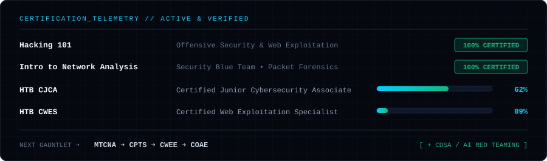

  <!-- Main Hero Banner -->
  
    
  <!-- Minimalist One-Line Action Buttons -->
  
  &nbsp;&nbsp;
  
  &nbsp;&nbsp;
  

 

<!-- Clean Floating ASCII Portrait paired ONLY with Intro -->

### `> whoami`

Growing organizations, startups, and financial firms face the exact same cyber threats as large enterprises—rarely with the same massive budgets or dedicated internal teams to fight them. **That is the gap I help close.**

I combine **offensive penetration testing** with **enterprise infrastructure and SecOps engineering** to build secure, scalable, and resilient environments. My core passion lies in **SaaS & Web Application Penetration Testing**—breaking systems manually to uncover authentication flaws, access control bypasses, and business logic vulnerabilities before adversaries can. Alongside offensive testing, I architect and operate the defensive backbone for **Speedway Sentinel**, our dedicated MSSP wing.

* **Core Focus Areas:** `SaaS & Web App Pentesting` · `SecOps & SOC` · `MSSP Architecture` · `Infrastructure & NetSec` · `Security Automation`
* **Handles & Contact:** `dark_lemur` *(Bug Hunting)* &nbsp;•&nbsp; `x_sekigan` *(Tooling)* &nbsp;•&nbsp; `xsekigan@gmail.com` &nbsp;•&nbsp; `nissanmis16du@gmail.com`

 

---

### `> experience // Speedway Solutions Ltd.` *(1 Yr • Dhaka, Bangladesh)*

#### **IT & Cybersecurity Analyst** *(Full-time • Apr 2026 – Present)*
Leading the engineering and defense of enterprise infrastructure while driving the technical architecture and client-facing security solutions for **Speedway Sentinel** (dedicated MSSP wing).

* **SaaS & Web App Penetration Testing:** Primary offensive security tester for internal web assets, production websites, corporate networks, and multi-tenant SaaS platforms—executing manual assessments for **authentication bypasses, pre-2FA token scope flaws, cross-tenant IDOR/BOLA, Stored XSS, Blind SSRF, and business logic vulnerabilities**.
* **MSSP Architecture (Speedway Sentinel):** Designing a scalable multi-tenant MSSP ecosystem covering RMM/EDR, endpoint protection, patch management, telemetry collection, threat monitoring, detection & response workflows, backup, identity security, vulnerability management, exposure monitoring, automation, reporting, and tiered managed-security services.
* **SOC Operations (Wazuh SIEM/XDR):** Deployed and manage a centralized SIEM stack—fine-tuning log pipelines, authoring custom decoders, and investigating endpoint telemetry for anomalous behavior and threats.
* **Enterprise Networking & Edge Defense:** Redesigned and migrated the corporate network; built and manage the core LAN/WAN on `MikroTik` and `Cisco` with strict VLAN segmentation, LACP, Hairpin NAT, and hardened firewall policies.
* **Full-Stack SysAdmin & Resilience:** Maintain the on-prem production server cluster on `Proxmox VE`, managing HA VMs, IAM/MFA, and automated air-gapped disaster recovery pipelines using `Restic` and `Backblaze B2`.
* **Governance, Policy & SOPs:** Authored the organization’s foundational cybersecurity framework, defining device access controls and technical SOPs aligned with enterprise compliance and audit standards.

#### **Network Security & IT Intern** *(Internship • Dec 2025 – Apr 2026 • 5 mos)*
* **Infrastructure & SysAdmin:** Managed and secured LAN/WAN/VPN, firewalls, routers, and cloud/on-prem servers alongside IAM/MFA and Tier 1–3 technical operations.
* **Cybersecurity, Compliance & IR:** Implemented EDR controls, conducted vulnerability scans, maintained IT SOPs and network diagrams for client audits, and led incident detection, remediation, and disaster recovery workflows.

---

### `> offensive_research & security_builds`

* **External Bug Bounty & VDP Research (`dark_lemur`):** Active web and API vulnerability researcher hunting across HackerOne, Bugcrowd, and public/private VDPs.
* **SpecTre-Q (`x_sekigan`):** Custom Python CLI security utility engineered for k-anonymity dark web breach lookups, password entropy auditing, IP reputation checks, and automated PDF reporting.
* **Corporate Threat Detection Honeypot:** Deployed and tuned a `Suricata`-powered network honeypot to capture internal recon telemetry and attacker TTPs.

---

### `> certification_telemetry`

  

---

### `> technical_arsenal`

  

 

* **Offensive & Web App Pentesting:** `Burp Suite` · `Nmap` · `ffuf` · `dirsearch` · `Katana` · `Subfinder` · `Sublist3r` · `httpx` · `Nessus` · `WPScan` · `Nikto` · `theHarvester` · `Proxychains4` · `LinPEAS` · `OWASP Top 10`
* **White-Box & Automation:** `Python` · `Go (Golang)` · `JavaScript` · `HTML5` · `Bash` · `PowerShell` · `CMD`
* **SecOps, Infra & Forensics:** `Wazuh SIEM` · `Suricata` · `Bitdefender GravityZone` · `Huntress` · `NinjaOne` · `FleetDM` · `Proxmox VE` · `Wireshark` · `tcpdump` · `MikroTik` · `Cisco` · `WireGuard` · `Restic` · `Backblaze B2`

---

  
<code>> cat ./archive/data_analytics.log</code> <i>(Retired BI &amp; Analytics Background)</i>

   
  <ul>
    <li><b>Stack:</b> SQL (MySQL, BigQuery, Oracle), Power BI, DAX, Excel, Looker Studio, Pandas, NumPy, Statistical ML.</li>
    <li><b>Credentials:</b> Top Performer — BI Analytics Bootcamp (Akaademy), Codebasics Data Analytics Bootcamp, Business Analytics with Excel (Johns Hopkins).</li>
  </ul>

