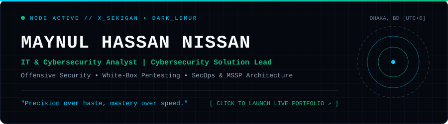

  <!-- Clickable Sentinel Hero Banner -> Opens Your Live Interactive Portfolio -->
  

    

  <!-- Primary Action & Identity Badges -->
  
  
  

 

<!-- 2-Column Layout: Identity & Roles + Your Live ASCII Portrait -->
<table>
  <tr>
    <td width="65%" valign="top">
      <h3><code>> whoami</code></h3>
      

        I operate at the intersection of <b>breaking systems</b> and <b>architecting resilient defenses</b>. By day, I lead cybersecurity solution engineering, on-premise Linux infrastructure, and SecOps pipelines. By night, I hunt web &amp; API vulnerabilities under <code>dark_lemur</code> and develop offensive/defensive tooling under <code>x_sekigan</code>.
      

      <h4><code>> current_roles</code></h4>
      <ul>
        <li><b>Cybersecurity Solution Lead</b> @ <i>Speedway Sentinel</i> — Leading the security wing, designing MSSP service tiers, and building the end-to-end SecOps &amp; EDR stack.</li>
        <li><b>IT &amp; Cybersecurity Analyst</b> @ <i>Speedway Solutions Ltd.</i> — Managing virtualization (Proxmox), enterprise networking (MikroTik/Cisco), and endpoint defense.</li>
      </ul>
      

        <b>Direct Channels:</b> <code>xsekigan@gmail.com</code> &nbsp;|&nbsp; <code>nissanmis16du@gmail.com</code>
      

    </td>
    <td width="35%" align="center" valign="middle">
      
       
      <code>// x_sekigan</code>
    </td>
  </tr>
</table>

---

### `> key_operations & security_research`

* **SpecTre-Q (CLI Security Utility):** Custom Python CLI tool engineered for k-anonymity dark web breach lookups, password entropy auditing, IP reputation checks, and automated reporting.
* **MSSP & SecOps Stack Engineering:** Architected multi-tenant defensive operations integrating `NinjaOne`, `Huntress`, `Bitdefender GravityZone`, `Wazuh SIEM`, `Entra ID`, `FleetDM`, `MeshCentral`, `Backblaze B2`, `Restic`, `HIBP`, and `IntelX`.
* **Corporate Threat Detection Honeypot:** Deployed and tuned a `Suricata`-powered network honeypot to capture recon telemetry and attacker TTPs across internal perimeters.
* **Web & API Vulnerability Research:** Discovered and reported high-impact flaws in production/staging targets (anonymized), including pre-2FA `tempToken` scope bypasses, cross-tenant BOLA/IDOR, and WordPress security misconfigurations.

---

### `> certification_telemetry`

| Certification / Track | Focus Area | Status |
| :--- | :--- | :--- |
| **Hacking 101** | Offensive Security & Web Exploitation Fundamentals | `Certified` |
| **Intro to Network Analysis** *(Security Blue Team)* | Packet Inspection, Wireshark & Traffic Forensics | `Certified` |
| **HTB CJCA** *(Certified Junior Cybersecurity Associate)* | Junior Pentesting & Defensive Foundations | `62% In Progress` |
| **HTB CWES** *(Certified Web Exploitation Specialist)* | Advanced Web App & API Exploitation | `9% In Progress` |
| **Upcoming Gauntlet** | `MTCNA` ➔ `CPTS` ➔ `CWEE` ➔ `COAE` *(+ `CDSA` / AI Red Teaming)* | `Queued` |

---

### `> technical_arsenal`

  

 

* **White-Box & Scripting:** `Python` · `Go (Golang)` · `JavaScript` · `HTML5` · `Bash` · `PowerShell` · `CMD`
* **Offensive & Recon:** `Burp Suite` · `Nmap` · `ffuf` · `dirsearch` · `Katana` · `Subfinder` · `Sublist3r` · `httpx` · `Nessus` · `WPScan` · `Nikto` · `theHarvester` · `Proxychains4` · `LinPEAS` · `OWASP Top 10`
* **Network & Forensics:** `Wireshark` · `tcpdump` · `Suricata` · `dig` · `nslookup` · `whois` · `ufw` · `netstat` · `MikroTik` · `Cisco` · `WireGuard`

---

  
<code>> cat ./archive/data_analytics.log</code> <i>(Retired BI &amp; Analytics Background)</i>

   
  <ul>
    <li><b>Stack:</b> SQL (MySQL, BigQuery, Oracle), Power BI, DAX, Excel, Looker Studio, Pandas, NumPy, Statistical ML.</li>
    <li><b>Credentials:</b> Top Performer — BI Analytics Bootcamp (Akaademy), Codebasics Data Analytics Bootcamp, Business Analytics with Excel (Johns Hopkins).</li>
  </ul>

